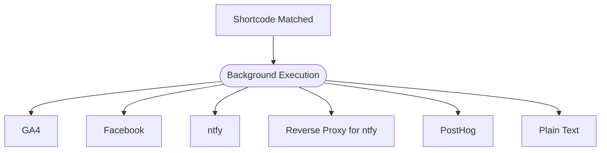

import { Terminology } from '@cbnventures/docusaurus-preset-nova/blocks';

Attach server-side analytics integrations that fire automatically on every matched <Terminology title="path segment that maps to a URL" to="/docs/reference/terminology#shortcode">shortcode</Terminology> redirect.

## How Trackers Work

Client-side analytics can't work here — browsers act on a redirect's `Location` header without ever rendering the response body, so embedded tracking scripts never get the chance to run. <Terminology title="background analytics integration on a link" to="/docs/reference/terminology#tracker">Trackers</Terminology> fire server-side instead: when a request matches a configured <Terminology title="path segment that maps to a URL" to="/docs/reference/terminology#shortcode">shortcode</Terminology>, the <Terminology title="edge function that serves your redirects" to="/docs/reference/terminology#cloudflare-worker">worker</Terminology> fires all configured <Terminology title="background analytics integration on a link" to="/docs/reference/terminology#tracker">trackers</Terminology> in parallel in the background so the redirect response is never delayed by analytics calls.

Individual <Terminology title="background analytics integration on a link" to="/docs/reference/terminology#tracker">tracker</Terminology> failures don't affect other <Terminology title="background analytics integration on a link" to="/docs/reference/terminology#tracker">trackers</Terminology> or the redirect. The <Terminology title="edge function that serves your redirects" to="/docs/reference/terminology#cloudflare-worker">worker</Terminology> silently handles failed <Terminology title="background analytics integration on a link" to="/docs/reference/terminology#tracker">trackers</Terminology> and does not log errors to the <Terminology title="edge function that serves your redirects" to="/docs/reference/terminology#cloudflare-worker">worker</Terminology> logs.

To confirm <Terminology title="background analytics integration on a link" to="/docs/reference/terminology#tracker">trackers</Terminology> are firing, you can check the receiving service's dashboard (<Terminology title="Google Analytics 4 tracker type" to="/docs/reference/terminology#ga4">GA4</Terminology>, <Terminology title="PostHog event capture tracker type" to="/docs/reference/terminology#posthog">PostHog</Terminology>, etc.) or use the <Terminology title="plain-text webhook tracker type" to="/docs/reference/terminology#plain-text">plain-text</Terminology> <Terminology title="background analytics integration on a link" to="/docs/reference/terminology#tracker">tracker</Terminology> type to send notifications to an endpoint you control.



## Tracker Types

Every <Terminology title="background analytics integration on a link" to="/docs/reference/terminology#tracker">tracker</Terminology> object requires a `name` field (unique identifier) and a `type` field that determines which additional fields are required. Extra fields are rejected.

---

### GA4 (Google Analytics 4)

Send `select_content` events to <Terminology title="Google Analytics 4 tracker type" to="/docs/reference/terminology#ga4">Google Analytics 4</Terminology> via the Measurement Protocol server-side API.

#### Config Fields

| Field            | Type     | Required | Description                                                |
|------------------|:--------:|----------|------------------------------------------------------------|
| `name`           | `string` |    Yes   | Unique <Terminology title="background analytics integration on a link" to="/docs/reference/terminology#tracker">tracker</Terminology> name. |
| `type`           | `string` |    Yes   | Must be `"ga4"`.                                           |
| `measurement_id` | `string` |    Yes   | <Terminology title="Google Analytics 4 tracker type" to="/docs/reference/terminology#ga4">GA4</Terminology> Measurement ID (e.g., `G-XXXXXXXXXX`). |
| `api_secret`     | `string` |    Yes   | <Terminology title="Google Analytics 4 tracker type" to="/docs/reference/terminology#ga4">GA4</Terminology> Measurement Protocol API secret. |

#### Example

```json title="config.json"
{
  "name": "my-ga4",
  "type": "ga4",
  "measurement_id": "G-XXXXXXXXXX",
  "api_secret": "your-api-secret"
}
```

#### Event Details

- **Endpoint:** `https://www.google-analytics.com/mp/collect`
- **Event name:** `select_content`
- **Parameters:** `content_type` (`short_link`), `content_id` (<Terminology title="path segment that maps to a URL" to="/docs/reference/terminology#shortcode">shortcode</Terminology>), `link_url` (redirect URL)
- **Client ID:** Extracted from the `CF-RAY` header, falls back to `"unknown"`.

Note: `CF-RAY` is a Cloudflare request identifier, not a persistent user identifier. Each request generates a unique `CF-RAY`, so <Terminology title="Google Analytics 4 tracker type" to="/docs/reference/terminology#ga4">GA4</Terminology> treats every redirect as a distinct client.

This is sufficient for counting events but doesn't support user-level attribution or session tracking.

#### How to Get Your Credentials

1. Go to **Google Analytics > Admin > Data Streams > your stream**.
2. Copy the **Measurement ID** (starts with `G-`).
3. Under **Measurement Protocol API secrets**, create a new secret and copy it.

---

### Facebook

Fire a <Terminology title="Meta Pixel PageView tracker type" to="/docs/reference/terminology#facebook">Facebook</Terminology> pixel PageView event via the noscript tracking endpoint.

#### Config Fields

| Field      | Type     | Required | Description                        |
|------------|:--------:|----------|------------------------------------|
| `name`     | `string` |    Yes   | Unique <Terminology title="background analytics integration on a link" to="/docs/reference/terminology#tracker">tracker</Terminology> name. |
| `type`     | `string` |    Yes   | Must be `"facebook"`.              |
| `pixel_id` | `string` |    Yes   | <Terminology title="Meta Pixel PageView tracker type" to="/docs/reference/terminology#facebook">Facebook</Terminology> Pixel ID. |

#### Example

```json title="config.json"
{
  "name": "my-facebook",
  "type": "facebook",
  "pixel_id": "123456789012345"
}
```

#### Event Details

- **Endpoint:** `https://www.facebook.com/tr?id=<pixel_id>&ev=PageView&noscript=1`
- **Method:** GET
- **Event:** PageView

#### How to Get Your Pixel ID

1. Go to **Meta Events Manager**.
2. Select your pixel under **Data Sources**.
3. Copy the **Pixel ID** from the overview page.

---

### ntfy

Send push notifications with full request details to an <Terminology title="push notification tracker type" to="/docs/reference/terminology#ntfy">ntfy</Terminology> server when a short link is visited.

#### Config Fields

| Field    | Type     | Required | Description                                                  |
|----------|:--------:|----------|--------------------------------------------------------------|
| `name`   | `string` |    Yes   | Unique <Terminology title="background analytics integration on a link" to="/docs/reference/terminology#tracker">tracker</Terminology> name. |
| `type`   | `string` |    Yes   | Must be `"ntfy"`.                                            |
| `server` | `string` |    Yes   | <Terminology title="push notification tracker type" to="/docs/reference/terminology#ntfy">ntfy</Terminology> server URL. Must start with `https://`. |
| `topic`  | `string` |    Yes   | <Terminology title="push notification tracker type" to="/docs/reference/terminology#ntfy">ntfy</Terminology> topic name. |
| `token`  | `string` |    Yes   | Authentication token. Must start with `tk_`.                 |

#### Example

```json title="config.json"
{
  "name": "my-ntfy",
  "type": "ntfy",
  "server": "https://ntfy.sh",
  "topic": "short-links",
  "token": "tk_your-token-here"
}
```

#### Event Details

- **Endpoint:** `<server>`
- **Method:** POST with Bearer token authorization
- **Content-Type:** `application/json`
- **Body:** JSON object with `topic`, `title`, `message` (Markdown-formatted), `tags`, `priority`, and `markdown` fields. The message includes <Terminology title="path segment that maps to a URL" to="/docs/reference/terminology#shortcode">shortcode</Terminology>, redirect URL, request method, request URL, Cloudflare geo data (country, city, ASN, coordinates, timezone), and request headers.

#### How to Get Your Token

1. Log into your <Terminology title="push notification tracker type" to="/docs/reference/terminology#ntfy">ntfy</Terminology> instance.
2. Go to **Account > Access Tokens**.
3. Generate a new token (starts with `tk_`).

---

### Reverse Proxy for ntfy

Send Markdown-formatted push notifications through an [ntfy-reverse-proxy](https://github.com/cbnventures/ntfy-reverse-proxy) endpoint with optional Bearer token authentication. Designed for users who deploy <Terminology title="single-URL ntfy notification tracker type" to="/docs/reference/terminology#reverse-proxy-for-ntfy">ntfy-reverse-proxy</Terminology> and configure it with a single URL instead of separate server and topic fields.

#### Config Fields

| Field   | Type     | Required | Description                                                  |
|---------|:--------:|----------|--------------------------------------------------------------|
| `name`  | `string` |    Yes   | Unique <Terminology title="background analytics integration on a link" to="/docs/reference/terminology#tracker">tracker</Terminology> name. |
| `type`  | `string` |    Yes   | Must be `"ntfy-reverse-proxy"`.                              |
| `url`   | `string` |    Yes   | <Terminology title="single-URL ntfy notification tracker type" to="/docs/reference/terminology#reverse-proxy-for-ntfy">ntfy-reverse-proxy</Terminology> endpoint URL. Must start with `https://`. |
| `token` | `string` |    No    | Optional authentication token for Bearer authorization.      |

#### Example

```json title="config.json"
{
  "name": "my-ntfy-proxy",
  "type": "ntfy-reverse-proxy",
  "url": "https://ntfy-proxy.example.com/alerts",
  "token": "your-bearer-token"
}
```

#### Event Details

- **Endpoint:** The configured `url`
- **Method:** POST with optional Bearer token authorization
- **Content-Type:** `text/plain`
- **Headers:** `Title: User Request Received`, `Tags: rotating_light`, `Priority: 2`, `Markdown: yes`
- **Body:** Markdown-formatted message with three sections:
  - **User Request** — <Terminology title="path segment that maps to a URL" to="/docs/reference/terminology#shortcode">shortcode</Terminology>, redirect URL, request method, request URL.
  - **Cloudflare Properties** — city, continent, country, data center, ISP, coordinates, postal code, region, timezone.
  - **Headers** — CF-Connecting-IP, CF-IPCountry, CF-RAY, Host, User-Agent, X-Real-IP.

The payload format is identical to the <Terminology title="push notification tracker type" to="/docs/reference/terminology#ntfy">ntfy</Terminology> <Terminology title="background analytics integration on a link" to="/docs/reference/terminology#tracker">tracker</Terminology>, making it compatible with <Terminology title="push notification tracker type" to="/docs/reference/terminology#ntfy">ntfy</Terminology>'s Markdown rendering. The difference is configuration: a single `url` pointing to your [ntfy-reverse-proxy](https://github.com/cbnventures/ntfy-reverse-proxy) endpoint instead of separate `server` and `topic` fields, and the authentication token is optional.

---

### PostHog

Capture a "User Request Captured" event to a <Terminology title="PostHog event capture tracker type" to="/docs/reference/terminology#posthog">PostHog</Terminology> instance with <Terminology title="path segment that maps to a URL" to="/docs/reference/terminology#shortcode">shortcode</Terminology> and redirect details.

#### Config Fields

| Field     | Type     | Required | Description                                               |
|-----------|:--------:|----------|-----------------------------------------------------------|
| `name`    | `string` |    Yes   | Unique <Terminology title="background analytics integration on a link" to="/docs/reference/terminology#tracker">tracker</Terminology> name. |
| `type`    | `string` |    Yes   | Must be `"posthog"`.                                      |
| `host`    | `string` |    Yes   | <Terminology title="PostHog event capture tracker type" to="/docs/reference/terminology#posthog">PostHog</Terminology> instance URL. Must start with `https://`. |
| `api_key` | `string` |    Yes   | <Terminology title="PostHog event capture tracker type" to="/docs/reference/terminology#posthog">PostHog</Terminology> project API key. |

#### Example

```json title="config.json"
{
  "name": "my-posthog",
  "type": "posthog",
  "host": "https://app.posthog.com",
  "api_key": "phc_your-project-api-key"
}
```

#### Event Details

- **Endpoint:** `<host>/i/v0/e/`
- **Method:** POST
- **Event name:** `User Request Captured`
- **Distinct ID:** `CF-RAY` header, then `CF-Connecting-IP` header, then `"unknown"`. Since `CF-Connecting-IP` is the client's IP address, <Terminology title="PostHog event capture tracker type" to="/docs/reference/terminology#posthog">PostHog</Terminology> can group events by IP when `CF-RAY` is unavailable.
- **Properties:** `shortcode`, `redirect_url`, `$current_url` (original request URL)

#### How to Get Your Credentials

1. Go to **PostHog > Project Settings**.
2. Copy the **Project API Key**.
3. Your **host** is your <Terminology title="PostHog event capture tracker type" to="/docs/reference/terminology#posthog">PostHog</Terminology> instance URL (e.g., `https://app.posthog.com` for cloud).

---

### Plain Text

Send a <Terminology title="plain-text webhook tracker type" to="/docs/reference/terminology#plain-text">plain text</Terminology> summary with full request and Cloudflare edge details to any webhook endpoint.

#### Config Fields

| Field   | Type     | Required | Description                                                  |
|---------|:--------:|----------|--------------------------------------------------------------|
| `name`  | `string` |    Yes   | Unique <Terminology title="background analytics integration on a link" to="/docs/reference/terminology#tracker">tracker</Terminology> name. |
| `type`  | `string` |    Yes   | Must be `"plain-text"`.                                      |
| `url`   | `string` |    Yes   | Webhook endpoint URL. Must start with `https://`.            |
| `token` | `string` |    No    | Optional Bearer token for authorization.                     |

#### Example

```json title="config.json"
{
  "name": "my-webhook",
  "type": "plain-text",
  "url": "https://ntfy.example.com/alerts",
  "token": "your-bearer-token"
}
```

#### Event Details

- **Endpoint:** The configured `url`
- **Method:** POST with optional Bearer token authorization
- **Content-Type:** `text/plain`
- **Body:** <Terminology title="plain-text webhook tracker type" to="/docs/reference/terminology#plain-text">Plain text</Terminology> message with three sections:
  - **User Request** — <Terminology title="path segment that maps to a URL" to="/docs/reference/terminology#shortcode">shortcode</Terminology>, redirect URL, request method, request URL.
  - **Cloudflare Properties** — city, continent, country, data center, ISP, coordinates, postal code, region, timezone.
  - **Headers** — CF-Connecting-IP, CF-IPCountry, CF-RAY, Host, User-Agent, X-Real-IP.

The <Terminology title="plain-text webhook tracker type" to="/docs/reference/terminology#plain-text">plain text</Terminology> format contains the same data as the <Terminology title="push notification tracker type" to="/docs/reference/terminology#ntfy">ntfy</Terminology> and <Terminology title="single-URL ntfy notification tracker type" to="/docs/reference/terminology#reverse-proxy-for-ntfy">ntfy-reverse-proxy</Terminology> <Terminology title="background analytics integration on a link" to="/docs/reference/terminology#tracker">trackers</Terminology> but without Markdown formatting. It can be consumed by any webhook receiver that accepts `text/plain` POST requests.

---

## Multiple Trackers

You can configure as many <Terminology title="background analytics integration on a link" to="/docs/reference/terminology#tracker">trackers</Terminology> as you need. All <Terminology title="background analytics integration on a link" to="/docs/reference/terminology#tracker">trackers</Terminology> fire on every matched <Terminology title="path segment that maps to a URL" to="/docs/reference/terminology#shortcode">shortcode</Terminology> redirect:

```json title="config.json"
{
  "trackers": [
    { "name": "analytics", "type": "ga4", "measurement_id": "G-XXX", "api_secret": "xxx" },
    { "name": "notifications", "type": "ntfy", "server": "https://ntfy.sh", "topic": "links", "token": "tk_xxx" },
    { "name": "product", "type": "posthog", "host": "https://app.posthog.com", "api_key": "phc_xxx" }
  ]
}
```

## Managing Trackers

Use the interactive menu or CLI commands:

```bash
# Interactive management
bsl
# Select "Manage trackers"

# Remove a tracker directly
bsl trackers remove my-ga4
```

The interactive menu supports add, edit, and remove operations for <Terminology title="background analytics integration on a link" to="/docs/reference/terminology#tracker">trackers</Terminology> with input validation for each <Terminology title="background analytics integration on a link" to="/docs/reference/terminology#tracker">tracker</Terminology> type's required fields.
