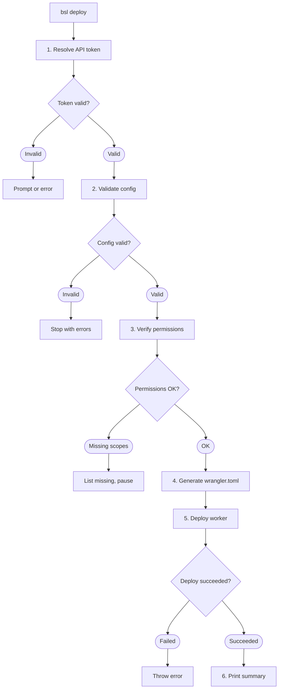

import { Terminology } from '@cbnventures/docusaurus-preset-nova/blocks';

Deploy your branded short links to <Terminology title="edge function that serves your redirects" to="/docs/reference/terminology#cloudflare-worker">Cloudflare Workers</Terminology> with a single command that handles validation, configuration generation, and deployment.



## Prerequisites

- A Cloudflare account with a registered domain.
- A Cloudflare <Terminology title="Cloudflare credential authorizing CLI deployments" to="/docs/reference/terminology#api-token">API token</Terminology> with the required permissions (see below).
- A valid `config.json` with at least one <Terminology title="single shortcode-to-URL config entry" to="/docs/reference/terminology#link-item">link item</Terminology> configured.

## API Token Setup

### Create the Token

1. Go to **Cloudflare Dashboard > My Profile > API Tokens**.
2. Click **Create Token**.
3. Use the **Custom token** template.
4. Add these permissions:

| Scope   | Resource            | Permission |
|---------|---------------------|------------|
| Account | Workers Scripts     | Edit       |
| Zone    | Workers Routes      | Edit       |
| Zone    | Email Routing Rules | Edit       |

The Email Routing Rules permission is required when the Cloudflare zone has email routing enabled. The deploy process verifies all three permissions and reports which are missing.

5. Under **Zone Resources**, select the zone that contains your <Terminology title="domain your shortcodes live on" to="/docs/reference/terminology#base-domain">base domain</Terminology>.
6. Click **Continue to summary**, then **Create Token**.
7. Copy the <Terminology title="Cloudflare credential authorizing CLI deployments" to="/docs/reference/terminology#api-token">token</Terminology> and store it securely.

### Store the Token

The CLI stores your <Terminology title="Cloudflare credential authorizing CLI deployments" to="/docs/reference/terminology#api-token">API token</Terminology> in `~/.config/branded-short-links/.env`:

```text title=".env"
CLOUDFLARE_API_TOKEN="your-token-here"
```

During the first deploy, if no <Terminology title="Cloudflare credential authorizing CLI deployments" to="/docs/reference/terminology#api-token">token</Terminology> is found, the CLI prompts you to enter one interactively. It verifies the <Terminology title="Cloudflare credential authorizing CLI deployments" to="/docs/reference/terminology#api-token">token</Terminology> against the Cloudflare API before saving.

## Deploy Command

Run the deploy from the CLI:

```bash
bsl deploy
```

Or from the interactive menu by selecting **Deploy**.

## Deployment Steps

The deploy command runs these steps in sequence:

### 1. Resolve API Token

Loads the Cloudflare <Terminology title="Cloudflare credential authorizing CLI deployments" to="/docs/reference/terminology#api-token">API token</Terminology> from the `.env` file (resolved from current directory, project root, or `~/.config/branded-short-links/`) or the `CLOUDFLARE_API_TOKEN` environment variable.

- **Interactive menu** — Prompts you to enter a <Terminology title="Cloudflare credential authorizing CLI deployments" to="/docs/reference/terminology#api-token">token</Terminology> if none is found.
- **Direct command (`bsl deploy`)** — Throws an error instead of prompting.

### 2. Validate Config

Runs the same checks as `bsl validate`:

- Schema validation for settings, links, and <Terminology title="background analytics integration on a link" to="/docs/reference/terminology#tracker">trackers</Terminology>.
- Duplicate <Terminology title="path segment that maps to a URL" to="/docs/reference/terminology#shortcode">shortcode</Terminology> detection.
- Duplicate <Terminology title="background analytics integration on a link" to="/docs/reference/terminology#tracker">tracker</Terminology> name detection.

Deployment stops if validation fails.

### 3. Verify Permissions

Checks that the <Terminology title="Cloudflare credential authorizing CLI deployments" to="/docs/reference/terminology#api-token">API token</Terminology> has the three required permission scopes against your configured `base_domain`. The CLI resolves the Cloudflare zone by progressively trying shorter domain segments until it finds a match.

If permissions are missing, the CLI lists which scopes need to be added and pauses for you to update the <Terminology title="Cloudflare credential authorizing CLI deployments" to="/docs/reference/terminology#api-token">token</Terminology>.

### 4. Generate wrangler.toml

Creates a `wrangler.toml` file with:

- <Terminology title="edge function that serves your redirects" to="/docs/reference/terminology#cloudflare-worker">Worker</Terminology> name from `settings.worker_name`.
- Compatibility date (set to the current date).
- Account ID (derived from zone info during permission verification).
- <Terminology title="Workers route bound to the full path" to="/docs/reference/terminology#custom-domain">Custom domain</Terminology> routes for the <Terminology title="domain your shortcodes live on" to="/docs/reference/terminology#base-domain">base domain</Terminology>. Two-part domains (e.g., `example.com`) also get a `www.` route.
- <Terminology title="the config.json deployment settings file" to="/docs/reference/terminology#config">Config</Terminology> sections (`SETTINGS`, `LINKS`, `TRACKERS`) serialized as JSON string environment variables.
- Main entry point pointing to the built <Terminology title="edge function that serves your redirects" to="/docs/reference/terminology#cloudflare-worker">worker</Terminology> script.

### 5. Deploy Worker

Runs `wrangler deploy --config wrangler.toml` with the account ID derived from the permission verification step. The <Terminology title="Cloudflare's Workers deployment CLI" to="/docs/reference/terminology#wrangler">Wrangler</Terminology> CLI handles uploading the <Terminology title="edge function that serves your redirects" to="/docs/reference/terminology#cloudflare-worker">worker</Terminology> bundle to Cloudflare.

### 6. Print Summary

Displays a summary of all configured short links with their <Terminology title="path segment that maps to a URL" to="/docs/reference/terminology#shortcode">shortcodes</Terminology>, redirect URLs, HTTP response codes, and attached <Terminology title="background analytics integration on a link" to="/docs/reference/terminology#tracker">tracker</Terminology> names.

## Custom Domain Routes

The CLI generates <Terminology title="edge function that serves your redirects" to="/docs/reference/terminology#cloudflare-worker">Cloudflare Workers</Terminology> <Terminology title="Workers route bound to the full path" to="/docs/reference/terminology#custom-domain">custom domain</Terminology> routes based on your `base_domain`:

| Base Domain      | Generated Routes                                                                                                                                                                                                                                                                                               |
|------------------|----------------------------------------------------------------------------------------------------------------------------------------------------------------------------------------------------------------------------------------------------------------------------------------------------------------|
| `example.com`    | `example.com` (<Terminology title="Workers route bound to the full path" to="/docs/reference/terminology#custom-domain">custom domain</Terminology>), `www.example.com` (<Terminology title="Workers route bound to the full path" to="/docs/reference/terminology#custom-domain">custom domain</Terminology>) |
| `go.example.com` | `go.example.com` (<Terminology title="Workers route bound to the full path" to="/docs/reference/terminology#custom-domain">custom domain</Terminology>)                                                                                                                                                        |

Two-part domains automatically get a `www.` variant. Three-or-more-part domains (subdomains) get a single route.

## Cloudflare Domain Requirements

- **A registered domain is required.** You can register domains within Cloudflare at cost with no markup via [Cloudflare Registrar](https://www.cloudflare.com/products/registrar/).
- **<Terminology title="Workers route bound to the full path" to="/docs/reference/terminology#custom-domain">Custom domains</Terminology> only.** The <Terminology title="edge function that serves your redirects" to="/docs/reference/terminology#cloudflare-worker">worker</Terminology> uses <Terminology title="edge function that serves your redirects" to="/docs/reference/terminology#cloudflare-worker">Cloudflare Workers</Terminology> <Terminology title="Workers route bound to the full path" to="/docs/reference/terminology#custom-domain">custom domains</Terminology> (`custom_domain = true` in the generated routes). Standard <Terminology title="edge function that serves your redirects" to="/docs/reference/terminology#cloudflare-worker">Cloudflare Workers</Terminology> routes (`custom_domain = false`) are not supported because the <Terminology title="path segment that maps to a URL" to="/docs/reference/terminology#shortcode">shortcode</Terminology> matcher relies on the full path from the domain root.
- **DNS is managed automatically.** When you deploy with a <Terminology title="Workers route bound to the full path" to="/docs/reference/terminology#custom-domain">custom domain</Terminology>, Cloudflare creates the necessary DNS records. You don't need to configure DNS manually.

## Local Development

Start a local development server with <Terminology title="Cloudflare's Workers deployment CLI" to="/docs/reference/terminology#wrangler">Wrangler</Terminology>:

```bash
npm run dev
```

This generates a temporary `wrangler.toml` if one doesn't exist and starts `wrangler dev` with a local upstream. You can test your <Terminology title="path segment that maps to a URL" to="/docs/reference/terminology#shortcode">shortcode</Terminology> redirects and <Terminology title="branded page served at the root" to="/docs/reference/terminology#landing-page">landing page</Terminology> locally before deploying.

## Post-Deploy Verification

After deploying, you can verify your setup:

1. Visit `https://yourdomain.com/` in a browser. You should see the <Terminology title="branded page served at the root" to="/docs/reference/terminology#landing-page">landing page</Terminology> (if no <Terminology title="redirect used when no shortcode matches" to="/docs/reference/terminology#fallback-url">fallback URL</Terminology> is set) or be redirected to the <Terminology title="redirect used when no shortcode matches" to="/docs/reference/terminology#fallback-url">fallback URL</Terminology>.
2. Visit `https://yourdomain.com/your-shortcode` and confirm it redirects to the correct destination.
3. Check your analytics dashboards (<Terminology title="Google Analytics 4 tracker type" to="/docs/reference/terminology#ga4">GA4</Terminology>, <Terminology title="PostHog event capture tracker type" to="/docs/reference/terminology#posthog">PostHog</Terminology>, etc.) to confirm <Terminology title="background analytics integration on a link" to="/docs/reference/terminology#tracker">tracker</Terminology> events are arriving.
4. Tail live <Terminology title="edge function that serves your redirects" to="/docs/reference/terminology#cloudflare-worker">worker</Terminology> logs to see redirect and <Terminology title="background analytics integration on a link" to="/docs/reference/terminology#tracker">tracker</Terminology> activity:

```bash
npm run tail
```

## Redeployment

After changing your <Terminology title="the config.json deployment settings file" to="/docs/reference/terminology#config">config</Terminology> (adding links, updating <Terminology title="background analytics integration on a link" to="/docs/reference/terminology#tracker">trackers</Terminology>, changing settings), redeploy with the same command:

```bash
bsl deploy
```

The CLI regenerates `wrangler.toml` from the current <Terminology title="the config.json deployment settings file" to="/docs/reference/terminology#config">config</Terminology> on every deploy, so your changes are always reflected.
