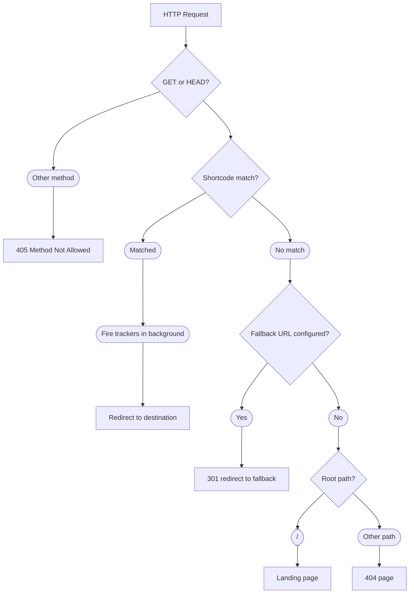

import { Terminology } from '@cbnventures/docusaurus-preset-nova/blocks';

Set up Branded Short Links on your own domain in minutes with an interactive CLI and <Terminology title="edge function that serves your redirects" to="/docs/reference/terminology#cloudflare-worker">Cloudflare Workers</Terminology>.

## Why Use Branded Short Links?

- Direct analytics tracking via server-side APIs (<Terminology title="Google Analytics 4 tracker type" to="/docs/reference/terminology#ga4">GA4</Terminology>, <Terminology title="Meta Pixel PageView tracker type" to="/docs/reference/terminology#facebook">Facebook</Terminology>, <Terminology title="PostHog event capture tracker type" to="/docs/reference/terminology#posthog">PostHog</Terminology>, <Terminology title="push notification tracker type" to="/docs/reference/terminology#ntfy">ntfy</Terminology>, <Terminology title="single-URL ntfy notification tracker type" to="/docs/reference/terminology#reverse-proxy-for-ntfy">Reverse Proxy for ntfy</Terminology>, <Terminology title="plain-text webhook tracker type" to="/docs/reference/terminology#plain-text">plain-text</Terminology>) so you don't depend on client-side JavaScript that browsers may block.
- Runs on <Terminology title="edge function that serves your redirects" to="/docs/reference/terminology#cloudflare-worker">Cloudflare Workers</Terminology> at the edge so redirects are fast and globally distributed with no origin server required.
- Interactive CLI manages your entire configuration so you never hand-edit JSON or TOML files.
- <Terminology title="Workers route bound to the full path" to="/docs/reference/terminology#custom-domain">Custom domain</Terminology> support so you can run short links like `yourdomain.com/github` that look professional and memorable.
- Lightweight single-<Terminology title="edge function that serves your redirects" to="/docs/reference/terminology#cloudflare-worker">worker</Terminology> deployment so there are no databases, admin panels, or user management overhead.

## How It Works

When a request arrives at your <Terminology title="Workers route bound to the full path" to="/docs/reference/terminology#custom-domain">custom domain</Terminology>, the <Terminology title="edge function that serves your redirects" to="/docs/reference/terminology#cloudflare-worker">Cloudflare Worker</Terminology> matches the path against your configured <Terminology title="path segment that maps to a URL" to="/docs/reference/terminology#shortcode">shortcodes</Terminology>. If a match is found, it fires all configured analytics <Terminology title="background analytics integration on a link" to="/docs/reference/terminology#tracker">trackers</Terminology> in the background and immediately returns a redirect response.

| Request                          | Result                                                                                                                                                                                                                                                                                 |
|----------------------------------|----------------------------------------------------------------------------------------------------------------------------------------------------------------------------------------------------------------------------------------------------------------------------------------|
| `https://yourdomain.com/github`  | Fires <Terminology title="background analytics integration on a link" to="/docs/reference/terminology#tracker">trackers</Terminology>, redirects to destination                                                                                                                        |
| `https://yourdomain.com/resume`  | Fires <Terminology title="background analytics integration on a link" to="/docs/reference/terminology#tracker">trackers</Terminology>, redirects to destination                                                                                                                        |
| `https://yourdomain.com/unknown` | Redirects to <Terminology title="redirect used when no shortcode matches" to="/docs/reference/terminology#fallback-url">fallback URL</Terminology> (if configured)                                                                                                                     |
| `https://yourdomain.com/`        | Redirects to <Terminology title="redirect used when no shortcode matches" to="/docs/reference/terminology#fallback-url">fallback</Terminology>, or shows <Terminology title="branded page served at the root" to="/docs/reference/terminology#landing-page">landing page</Terminology> |
| `https://yourdomain.com/missing` | Redirects to <Terminology title="redirect used when no shortcode matches" to="/docs/reference/terminology#fallback-url">fallback</Terminology>, or shows <Terminology title="page shown when nothing else matches" to="/docs/reference/terminology#404-page">404 page</Terminology>    |

<Terminology title="background analytics integration on a link" to="/docs/reference/terminology#tracker">Tracker</Terminology> events fire in the background so the redirect response is never delayed by analytics. <Terminology title="background analytics integration on a link" to="/docs/reference/terminology#tracker">Trackers</Terminology> are optional — you can deploy with an empty `"trackers": []` array and add them later.

## Prerequisites

| Tool    | Version     | Purpose                                |
|---------|-------------|----------------------------------------|
| Node.js | Current LTS | Runtime for the CLI and build pipeline |

You'll also need a Cloudflare account with a registered domain. Cloudflare offers [domain registration](https://www.cloudflare.com/products/registrar/) at cost with no markup.

## Next Steps

- [Quick Start](/docs/getting-started/quick-start/) walks you through installation and first deployment.
- [Configuration](/docs/configuration/settings/) covers all <Terminology title="the config.json deployment settings file" to="/docs/reference/terminology#config">config</Terminology> file options.
- [Trackers](/docs/configuration/trackers/) explains each analytics integration.
