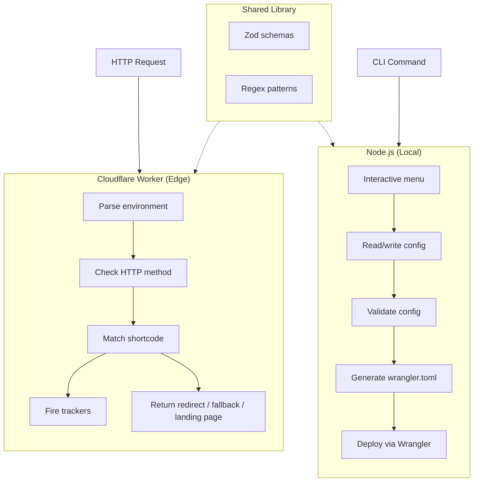
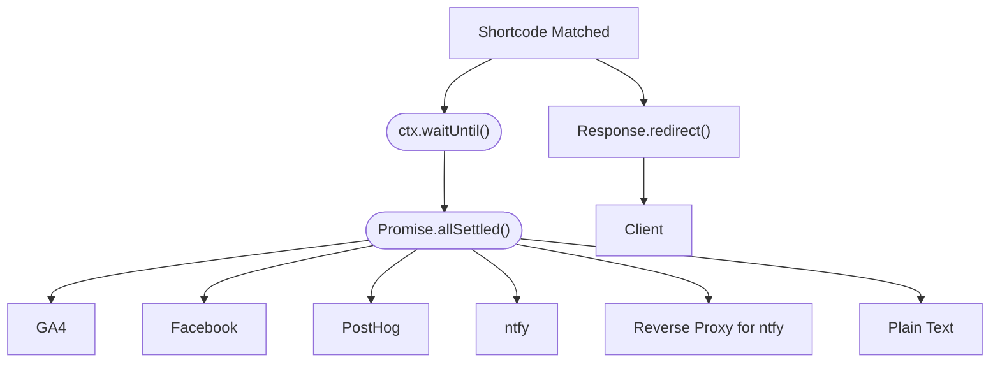
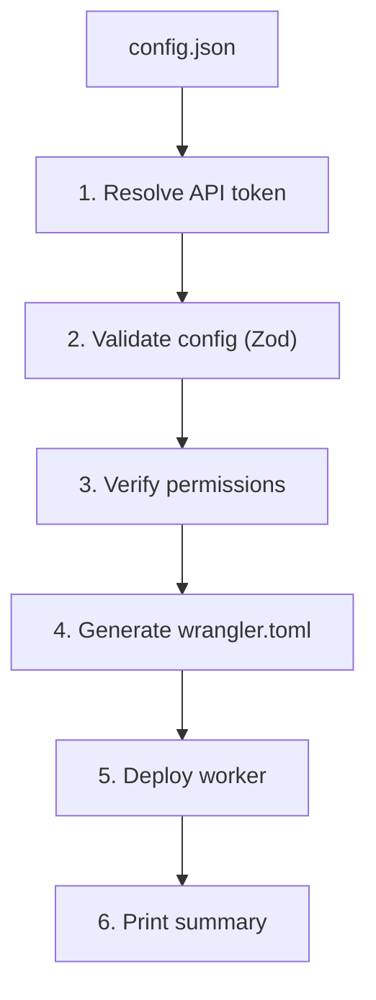

import { Terminology } from '@cbnventures/docusaurus-preset-nova/blocks';

Branded Short Links splits its work across two runtimes — a <Terminology title="edge function that serves your redirects" to="/docs/reference/terminology#cloudflare-worker">Cloudflare Worker</Terminology> that routes requests and fires analytics <Terminology title="background analytics integration on a link" to="/docs/reference/terminology#tracker">trackers</Terminology> at the edge, and a Node.js CLI that manages configuration locally.

## System Overview

The project has two entry points running on different runtimes:



The <Terminology title="edge function that serves your redirects" to="/docs/reference/terminology#cloudflare-worker">worker</Terminology> handles incoming HTTP requests at the edge. The CLI manages the configuration file that the <Terminology title="edge function that serves your redirects" to="/docs/reference/terminology#cloudflare-worker">worker</Terminology> reads at runtime.

## Request Flow

When a request arrives at the <Terminology title="edge function that serves your redirects" to="/docs/reference/terminology#cloudflare-worker">Cloudflare Worker</Terminology>:

1. **Parse environment** — The <Terminology title="edge function that serves your redirects" to="/docs/reference/terminology#cloudflare-worker">worker</Terminology> reads `SETTINGS`, `LINKS`, and `TRACKERS` from <Terminology title="Cloudflare's Workers deployment CLI" to="/docs/reference/terminology#wrangler">Wrangler</Terminology> environment variables (injected as JSON strings during deployment). It validates them against the Zod <Terminology title="the config.json deployment settings file" to="/docs/reference/terminology#config">config</Terminology> schema.

2. **Check HTTP method** — Only `GET` and `HEAD` requests are processed. All other methods return `405 Method Not Allowed`.

3. **Match <Terminology title="path segment that maps to a URL" to="/docs/reference/terminology#shortcode">shortcode</Terminology>** — The URL pathname is stripped of its trailing slash and matched against the configured <Terminology title="single shortcode-to-URL config entry" to="/docs/reference/terminology#link-item">link items</Terminology>.

4. **Route the response:**

| Condition                                                                                                                                                               | Response                                                                                                                                                                                     |
|-------------------------------------------------------------------------------------------------------------------------------------------------------------------------|----------------------------------------------------------------------------------------------------------------------------------------------------------------------------------------------|
| <Terminology title="path segment that maps to a URL" to="/docs/reference/terminology#shortcode">Shortcode</Terminology> matched                                         | Fire <Terminology title="background analytics integration on a link" to="/docs/reference/terminology#tracker">trackers</Terminology> in background, redirect with configured HTTP status     |
| No match, <Terminology title="redirect used when no shortcode matches" to="/docs/reference/terminology#fallback-url">fallback</Terminology> configured, root path (`/`) | Redirect to <Terminology title="redirect used when no shortcode matches" to="/docs/reference/terminology#fallback-url">fallback URL</Terminology> origin only (always 301)                   |
| No match, <Terminology title="redirect used when no shortcode matches" to="/docs/reference/terminology#fallback-url">fallback</Terminology> configured, other path      | Redirect to <Terminology title="redirect used when no shortcode matches" to="/docs/reference/terminology#fallback-url">fallback</Terminology> origin + original path/query/hash (always 301) |
| No match, no <Terminology title="redirect used when no shortcode matches" to="/docs/reference/terminology#fallback-url">fallback</Terminology>, root path (`/`)         | Serve the branded <Terminology title="branded page served at the root" to="/docs/reference/terminology#landing-page">landing page</Terminology> (200)                                        |
| No match, no <Terminology title="redirect used when no shortcode matches" to="/docs/reference/terminology#fallback-url">fallback</Terminology>, other path              | Serve the <Terminology title="page shown when nothing else matches" to="/docs/reference/terminology#404-page">404</Terminology> not-found page (404)                                         |

5. **Log event** — Every request logs a structured JSON payload to `console.info()` with the matched <Terminology title="path segment that maps to a URL" to="/docs/reference/terminology#shortcode">shortcode</Terminology> (or `null`), redirect URL, HTTP response code, and <Terminology title="background analytics integration on a link" to="/docs/reference/terminology#tracker">tracker</Terminology> names. You can view these logs in real time with `npm run tail`. Example payload:

```json
{
  "shortcode": "/github",
  "redirect_url": "https://github.com/yourname",
  "http_response": 301,
  "trackers": ["my-ga4", "my-ntfy"]
}
```

## Tracker Dispatch

<Terminology title="background analytics integration on a link" to="/docs/reference/terminology#tracker">Trackers</Terminology> fire in the background so the redirect response is returned immediately:



- All <Terminology title="background analytics integration on a link" to="/docs/reference/terminology#tracker">trackers</Terminology> fire in parallel via `Promise.allSettled()`.
- Individual failures don't affect other <Terminology title="background analytics integration on a link" to="/docs/reference/terminology#tracker">trackers</Terminology> or the redirect.
- Each <Terminology title="background analytics integration on a link" to="/docs/reference/terminology#tracker">tracker</Terminology> type makes its own HTTP request to the respective service's API endpoint.

## Landing Page

When a GET request hits the root path (`/`) and no <Terminology title="redirect used when no shortcode matches" to="/docs/reference/terminology#fallback-url">fallback URL</Terminology> is configured, the <Terminology title="edge function that serves your redirects" to="/docs/reference/terminology#cloudflare-worker">worker</Terminology> serves a branded HTML page:

- Project name and description.
- Link to the GitHub repository.
- Dark mode support via CSS custom properties (`prefers-color-scheme`).
- Fade-in animation.

When `show_response_output` is `true`, an expandable `<details>` element shows the <Terminology title="the config.json deployment settings file" to="/docs/reference/terminology#config">config</Terminology> with sensitive values masked (`••••••`). The masking function replaces:

- **Links** — `redirect_url` on every <Terminology title="single shortcode-to-URL config entry" to="/docs/reference/terminology#link-item">link item</Terminology>.
- **<Terminology title="Google Analytics 4 tracker type" to="/docs/reference/terminology#ga4">GA4</Terminology> <Terminology title="background analytics integration on a link" to="/docs/reference/terminology#tracker">trackers</Terminology>** — `measurement_id` and `api_secret`.
- **<Terminology title="Meta Pixel PageView tracker type" to="/docs/reference/terminology#facebook">Facebook</Terminology> <Terminology title="background analytics integration on a link" to="/docs/reference/terminology#tracker">trackers</Terminology>** — `pixel_id`.
- **<Terminology title="push notification tracker type" to="/docs/reference/terminology#ntfy">ntfy</Terminology> <Terminology title="background analytics integration on a link" to="/docs/reference/terminology#tracker">trackers</Terminology>** — `server` and `token`.
- **<Terminology title="single-URL ntfy notification tracker type" to="/docs/reference/terminology#reverse-proxy-for-ntfy">Reverse Proxy for ntfy</Terminology> <Terminology title="background analytics integration on a link" to="/docs/reference/terminology#tracker">trackers</Terminology>** — `url` and optionally `token`.
- **<Terminology title="PostHog event capture tracker type" to="/docs/reference/terminology#posthog">PostHog</Terminology> <Terminology title="background analytics integration on a link" to="/docs/reference/terminology#tracker">trackers</Terminology>** — `host` and `api_key`.
- **<Terminology title="plain-text webhook tracker type" to="/docs/reference/terminology#plain-text">Plain-text</Terminology> <Terminology title="background analytics integration on a link" to="/docs/reference/terminology#tracker">trackers</Terminology>** — `url` and optionally `token`.

Settings (including `worker_name`, `base_domain`) and the `fallback_url` are shown unmasked.

A similar <Terminology title="page shown when nothing else matches" to="/docs/reference/terminology#404-page">404 page</Terminology> is served for unmatched paths when no <Terminology title="redirect used when no shortcode matches" to="/docs/reference/terminology#fallback-url">fallback URL</Terminology> is configured.

## Configuration Pipeline



The <Terminology title="the config.json deployment settings file" to="/docs/reference/terminology#config">config</Terminology> file is never deployed directly. The CLI serializes each section as a JSON string into <Terminology title="Cloudflare's Workers deployment CLI" to="/docs/reference/terminology#wrangler">Wrangler</Terminology> environment variables.

The <Terminology title="edge function that serves your redirects" to="/docs/reference/terminology#cloudflare-worker">worker</Terminology> parses these strings back into objects at runtime.

## Source Structure

```text
packages/branded-short-links/src/
|-- worker/                <-- Cloudflare Worker runtime
|   |-- index.ts           <-- Request handler, routing logic
|   |-- trackers.ts        <-- Tracker dispatch (GA4, Facebook, ntfy, Reverse Proxy for ntfy, PostHog, plain-text)
|   '-- landing/
|       '-- page.ts        <-- Landing page and 404 page HTML generation
|-- cli/                   <-- Node.js CLI runtime
|   |-- index.ts           <-- CLI entry point (Commander)
|   |-- commands/
|   |   |-- config-io.ts   <-- Config file read/write
|   |   |-- deploy.ts      <-- Deployment orchestration (7 steps)
|   |   |-- generate.ts    <-- wrangler.toml generation
|   |   |-- links.ts       <-- Link CRUD operations
|   |   |-- settings.ts    <-- Settings read/update
|   |   |-- trackers.ts    <-- Tracker CRUD operations
|   |   '-- validate.ts    <-- Config schema + duplicate validation
|   '-- menu/
|       '-- interactive.ts <-- Interactive TUI menu (prompts)
|-- lib/
|   |-- schema.ts          <-- Zod validation schemas (all types)
|   |-- regex.ts           <-- Centralized regex patterns
|   '-- item.ts            <-- App name constant
'-- types/                 <-- TypeScript declarations (.d.ts), mirrors src/
```

<Terminology title="edge function that serves your redirects" to="/docs/reference/terminology#cloudflare-worker">Worker</Terminology> code and CLI code are cleanly separated because they run on different runtimes (<Terminology title="edge function that serves your redirects" to="/docs/reference/terminology#cloudflare-worker">Cloudflare Workers</Terminology> vs. Node.js). They share the `lib/` directory for schemas and utilities.

## Error Strategy

| Layer                                                                                                                                             | Strategy                                                                                                                                                                                                                                                                                                                                                                                                                                 |
|---------------------------------------------------------------------------------------------------------------------------------------------------|------------------------------------------------------------------------------------------------------------------------------------------------------------------------------------------------------------------------------------------------------------------------------------------------------------------------------------------------------------------------------------------------------------------------------------------|
| <Terminology title="edge function that serves your redirects" to="/docs/reference/terminology#cloudflare-worker">Worker</Terminology> entry point | Try/catch wraps the entire fetch handler. Returns JSON error response on failure.                                                                                                                                                                                                                                                                                                                                                        |
| <Terminology title="the config.json deployment settings file" to="/docs/reference/terminology#config">Config</Terminology> parsing                | Zod `safeParse` at request time validates env vars. Returns 500 with error issues on failure.                                                                                                                                                                                                                                                                                                                                            |
| <Terminology title="path segment that maps to a URL" to="/docs/reference/terminology#shortcode">Shortcode</Terminology> matching                  | No match falls through to <Terminology title="redirect used when no shortcode matches" to="/docs/reference/terminology#fallback-url">fallback URL</Terminology>, <Terminology title="branded page served at the root" to="/docs/reference/terminology#landing-page">landing page</Terminology>, or <Terminology title="page shown when nothing else matches" to="/docs/reference/terminology#404-page">404</Terminology>. Never crashes. |
| <Terminology title="background analytics integration on a link" to="/docs/reference/terminology#tracker">Tracker</Terminology> dispatch           | `Promise.allSettled()` catches individual failures silently. Never blocks.                                                                                                                                                                                                                                                                                                                                                               |
| CLI commands                                                                                                                                      | Try/catch at command level. Chalk-formatted errors. Non-zero exit code.                                                                                                                                                                                                                                                                                                                                                                  |
| <Terminology title="the config.json deployment settings file" to="/docs/reference/terminology#config">Config</Terminology> validation             | Zod schemas catch type mismatches, missing fields, invalid URLs, duplicates.                                                                                                                                                                                                                                                                                                                                                             |

## Data Collected Per Request

When <Terminology title="background analytics integration on a link" to="/docs/reference/terminology#tracker">trackers</Terminology> fire, they can access these data points from the <Terminology title="edge function that serves your redirects" to="/docs/reference/terminology#cloudflare-worker">Cloudflare Workers</Terminology> runtime. Each <Terminology title="background analytics integration on a link" to="/docs/reference/terminology#tracker">tracker</Terminology> type selects the subset of data relevant to its API. See [Trackers](/docs/configuration/trackers/) for what each type sends.

### Shortcode Properties

| Variable       | Description                                                                                                                                                   |
|----------------|---------------------------------------------------------------------------------------------------------------------------------------------------------------|
| `shortcode`    | The matched <Terminology title="path segment that maps to a URL" to="/docs/reference/terminology#shortcode">shortcode</Terminology> path (e.g., `/github`).   |
| `redirect_url` | The destination URL the <Terminology title="path segment that maps to a URL" to="/docs/reference/terminology#shortcode">shortcode</Terminology> redirects to. |

### Request Properties

| Variable         | Source           | Description                  |
|------------------|------------------|------------------------------|
| `request_method` | `request.method` | The HTTP method (GET, HEAD). |
| `request_url`    | `request.url`    | The full request URL.        |

### Request Headers

| Variable                 | Header             | Description                                         |
|--------------------------|--------------------|-----------------------------------------------------|
| `headers_cfConnectingIp` | `CF-Connecting-IP` | The client's IP address.                            |
| `headers_cfIpCountry`    | `CF-IPCountry`     | Two-letter country code of the client (e.g., `US`). |
| `headers_cfRay`          | `CF-RAY`           | Unique Cloudflare request identifier.               |
| `headers_host`           | `Host`             | The hostname from the request.                      |
| `headers_userAgent`      | `User-Agent`       | The client's user agent string.                     |
| `headers_xRealIp`        | `X-Real-IP`        | The client's real IP when behind a proxy.           |

### Cloudflare Edge Properties

These properties come from the `request.cf` object populated by Cloudflare's edge network.

| Variable            | Source                      | Description                                                              |
|---------------------|-----------------------------|--------------------------------------------------------------------------|
| `cf_asn`            | `request.cf.asn`            | ASN of the incoming request (e.g., `395747`).                            |
| `cf_asOrganization` | `request.cf.asOrganization` | Organization that owns the ASN (e.g., `Google Cloud`).                   |
| `cf_city`           | `request.cf.city`           | City of the incoming request (e.g., `Austin`).                           |
| `cf_colo`           | `request.cf.colo`           | Three-letter IATA airport code of the data center (e.g., `DFW`).         |
| `cf_continent`      | `request.cf.continent`      | Continent code (e.g., `NA`).                                             |
| `cf_country`        | `request.cf.country`        | Two-letter country code (e.g., `US`). Same as the `CF-IPCountry` header. |
| `cf_isEUCountry`    | `request.cf.isEUCountry`    | Returns `"1"` if the country is in the EU. Omitted otherwise.            |
| `cf_latitude`       | `request.cf.latitude`       | Latitude of the incoming request (e.g., `30.27130`).                     |
| `cf_longitude`      | `request.cf.longitude`      | Longitude of the incoming request (e.g., `-97.74260`).                   |
| `cf_metroCode`      | `request.cf.metroCode`      | DMA metro code (e.g., `635`).                                            |
| `cf_postalCode`     | `request.cf.postalCode`     | Postal code (e.g., `78701`).                                             |
| `cf_region`         | `request.cf.region`         | ISO 3166-2 region name (e.g., `Texas`).                                  |
| `cf_regionCode`     | `request.cf.regionCode`     | ISO 3166-2 region code (e.g., `TX`).                                     |
| `cf_timezone`       | `request.cf.timezone`       | IANA timezone (e.g., `America/Chicago`).                                 |

### Why Direct Tracking?

Traditional tag management systems like Google Tag Manager rely on embedding JavaScript in the browser. This doesn't work for URL shorteners because browsers immediately follow the `Location` header on a 3xx redirect response instead of loading the response body, so embedded analytics scripts never execute.

Branded Short Links solves this by firing analytics <Terminology title="background analytics integration on a link" to="/docs/reference/terminology#tracker">trackers</Terminology> server-side from the <Terminology title="edge function that serves your redirects" to="/docs/reference/terminology#cloudflare-worker">Cloudflare Worker</Terminology>, bypassing the browser entirely. This means:

- No client-side JavaScript required.
- No dependency on browser-side tag containers.
- Tracking works even when JavaScript is blocked or disabled.
- No `http-equiv` meta refresh redirects (which are bad for SEO).
